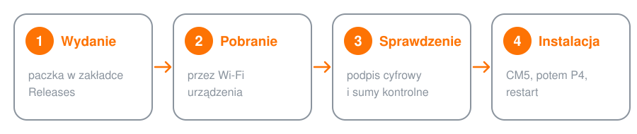

  <picture>
    <source media="(prefers-color-scheme: dark)" srcset="assets/wayven-logo-dark.svg">
    
  </picture>

<h3 align="center">Wayven OS: aktualizacje systemu radia preperskiego</h3>

  

---

## Co to jest

**Wayven** to kompaktowe radio na trudne czasy: łączność tekstowa LoRa, mapy offline, GPS, telewizja naziemna i odbiornik radiowy w jednej obudowie z dotykowym ekranem.

To repozytorium przechowuje **gotowe paczki systemu**. Urządzenie samo je stąd pobiera i instaluje. Nie ma tu kodu źródłowego, są tylko wydania.

## Jak zaktualizować urządzenie

1. Połącz urządzenie z Wi-Fi.
2. Wejdź w **Ustawienia → System** i dotknij **Sprawdź aktualizacje**.
3. Gdy pojawi się nowa wersja, przeczytaj listę zmian i dotknij **Zainstaluj**.

Na ekranie widać pasek postępu, przewidywany czas do końca i listę zmian. **Do końca aktualizacji nie wyłączaj urządzenia.** Na koniec uruchamia się ono ponownie z nową wersją.

  

## Co jest w wydaniu

| Plik | Do czego służy |
|---|---|
| `manifest.json` | numer wersji, lista zmian, rozmiary i sumy kontrolne plików |
| `manifest.sig` | podpis cyfrowy opisu wydania |
| `wayven-p4-<wersja>.bin` | system ekranu (ESP32-P4) |
| `wayven-cm5-<wersja>.tar.gz` | usługi komputera pokładowego (Raspberry Pi CM5): mapy, telewizja |

## Bezpieczeństwo aktualizacji

- **Tylko podpisane paczki.** Urządzenie sprawdza podpis cyfrowy każdego wydania. Paczki bez ważnego podpisu się nie instalują.
- **Sumy kontrolne.** Każdy plik jest sprawdzany po pobraniu. Uszkodzony plik nie zostanie zainstalowany.
- **Powrót do poprzedniej wersji.** Jeśli nowy system ekranu nie wystartuje poprawnie, urządzenie samo wraca do poprzedniego. To samo dotyczy usług CM5: gdy nowe nie odpowiadają, wraca poprzednia wersja.
- **Tylko przez Wi-Fi.** Urządzenie pobiera aktualizacje wyłącznie przez własne połączenie Wi-Fi.

## Wszystkie wersje

Lista wydań z opisem zmian: [Releases](https://github.com/ShamanFirst/Wayven-OS/releases).
