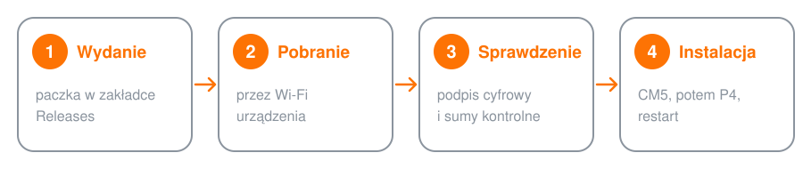

  <picture>
    <source media="(prefers-color-scheme: dark)" srcset="assets/wayven-logo-dark.svg">
    
  </picture>

<h3 align="center">Wayven OS: aktualizacje systemu radia preperskiego</h3>

  

---

## Co to jest

**Wayven** to kompaktowe radio na trudne czasy: łączność tekstowa LoRa, mapy offline, GPS, telewizja naziemna i internetowa, radio internetowe, odbiornik SDR oraz muzyka, filmy, zdjęcia i e-booki z karty microSD, w jednej obudowie z dotykowym ekranem.

To repozytorium przechowuje **gotowe paczki systemu** oraz cotygodniowe **listy stacji radiowych i kanałów TV** (przedwydania `radio-catalog` i `tv-catalog`). Urządzenie samo je stąd pobiera i instaluje.

## Jak zaktualizować urządzenie

**Przez Wi-Fi**

1. Połącz urządzenie z Wi-Fi.
2. Wejdź w **Ustawienia → Aktualizacja** i dotknij **Sprawdź**.
3. Gdy pojawi się nowa wersja, przeczytaj listę zmian i dotknij **Pobierz**. Pobieranie trwa w tle, z urządzenia można w tym czasie korzystać.
4. Dotknij **Instaluj** i potwierdź.

**Z karty pamięci (bez internetu)**

1. Pobierz z [Releases](https://github.com/ShamanFirst/Wayven-OS/releases) wszystkie pliki wydania (`manifest.json`, `manifest.sig`, `wayven-p4-<wersja>.bin`, `wayven-cm5-<wersja>.tar.gz`).
2. Skopiuj je do katalogu `Updates` na karcie przygotowanej przez Wayven i włóż kartę do urządzenia.
3. W **Ustawienia → Aktualizacja** dotknij **Z karty**.

Na ekranie widać, co się dzieje, i przewidywany czas do końca. **Do końca aktualizacji nie wyłączaj urządzenia.** Na koniec uruchamia się ono ponownie z nową wersją i pokazuje, jak poszła aktualizacja.

  

## Co jest w wydaniu

| Plik | Do czego służy |
|---|---|
| `manifest.json` | numer wersji, lista zmian, rozmiary i sumy kontrolne plików |
| `manifest.sig` | podpis cyfrowy opisu wydania |
| `wayven-p4-<wersja>.bin` | system ekranu (ESP32-P4) |
| `wayven-cm5-<wersja>.tar.gz` | usługi komputera pokładowego (Raspberry Pi CM5): mapy, telewizja naziemna i internetowa, SDR |

## Bezpieczeństwo aktualizacji

- **Tylko podpisane paczki.** Urządzenie sprawdza podpis cyfrowy każdego wydania. Paczki bez ważnego podpisu się nie instalują.
- **Sumy kontrolne.** Każdy plik jest sprawdzany po pobraniu. Uszkodzony plik nie zostanie zainstalowany.
- **Powrót do poprzedniej wersji.** Jeśli nowy system ekranu nie wystartuje poprawnie, urządzenie samo wraca do poprzedniego. To samo dotyczy usług CM5: gdy nowe nie odpowiadają, wraca poprzednia wersja.
- **Tylko przez Wi-Fi albo z karty.** Urządzenie pobiera aktualizacje wyłącznie przez własne połączenie Wi-Fi albo czyta je z własnej karty pamięci; podpis sprawdza w obu przypadkach.

## Wszystkie wersje

Lista wydań z opisem zmian: [Releases](https://github.com/ShamanFirst/Wayven-OS/releases).
